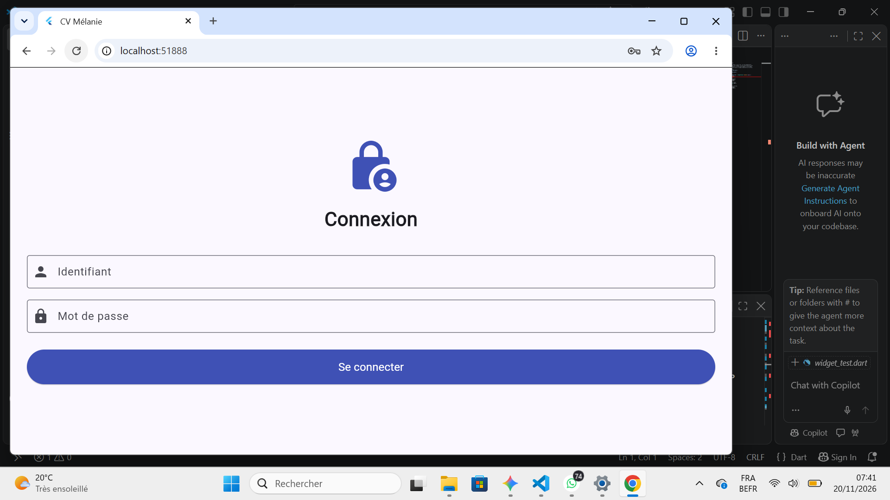

<<<<<<< HEAD
# cv_flutter_melanie
=======
# cv_flutter_melanie
## Captures_d'écran
### Rapport

### CV

### Famille

### Contact

>>>>>>> 28e478ed81f11208374f42cf7c7308edc71c5c90

## Captures d'écran

### Connexion

### CV

### Famille

### Contact

